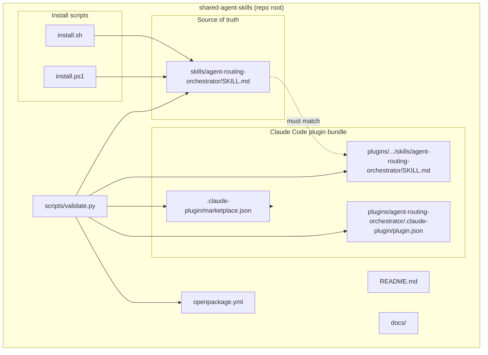
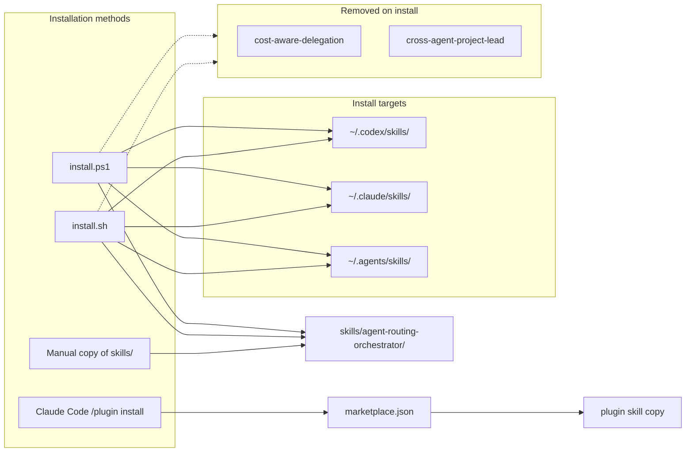
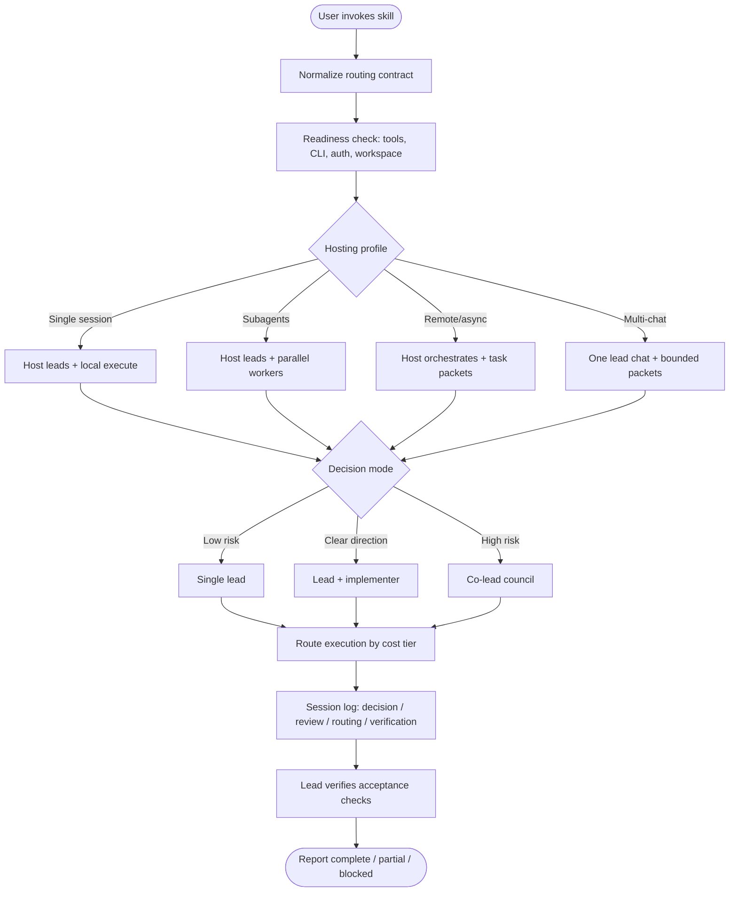
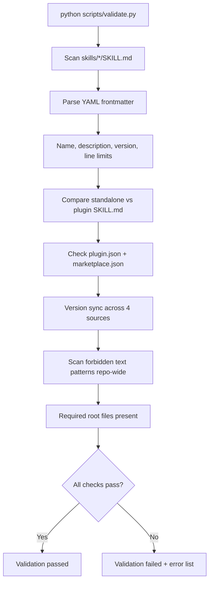

# Code Graph — shared-agent-skills

> **Version:** 0.5.0 · **Stack:** Markdown skills, JSON plugin metadata, Python validation, shell/PowerShell installers · **Type:** Portable agent-skill package (no runtime)

## Summary

`shared-agent-skills` is a project-agnostic distribution package for the **`agent-routing-orchestrator`** skill. It helps AI workflows decide who leads, who reviews, who executes, and how decisions are logged across Codex, Claude Code, subagents, remote coding agents, CI workers, and human-managed chats.

The repo is not an application server or library. It ships:

- A **standalone skill** (`skills/`) as the single source of truth
- A **Claude Code plugin mirror** (`plugins/`) kept byte-identical by validation
- **Install scripts** that copy skills into host-specific directories
- **Documentation** for usage and design principles
- A **validation script** that enforces structure, version sync, and drift prevention

There is no vendored agent runtime. External agents must already be installed and authenticated on the host.

---

## Package Topology



---

## Distribution & Install Flow



Install scripts remove legacy merged skills before copying the current skill. Targets: `codex`, `claude`, `agents`, `both` (codex+claude), or `all`.

---

## Skill Runtime Conceptual Model

When an agent host loads `agent-routing-orchestrator`, the skill drives a routing workflow—not executable code, but a structured decision process.



### Routing contract fields

| Field | Purpose |
|-------|---------|
| `Host` | Where the process is controlled (Codex, Claude Code, remote agent, CI, multi-chat) |
| `Lead` | Single lead, co-leads, or highest-quality host agent |
| `Review` | Peer, co-lead council, human, or none |
| `Execution` | Local, subagents, external agents, CI, human-assigned |
| `Cost mode` | `quality-first`, `balanced`, or `budget` |
| `Autonomy` | `autonomous`, `ask-on-stop-rules`, or `manual` |
| `Session log` | Chat only, durable file, or both |
| `Verification` | Tests, artifacts, review gates, acceptance criteria |

### Cost tiers

| Tier | Typical use | Escalate when |
|------|-------------|---------------|
| `cheap-fast` | Status checks, narrow docs, formatting | Ambiguity, coupling, irreversible edits |
| `standard` | Bounded implementation, bugfixes | Architecture, security, product direction |
| `frontier` | Architecture, hard debugging, acceptance gates | — (default for high-risk decisions) |

---

## Validation Pipeline



**Version sources that must match:** skill frontmatter (`shared-agent-skills.version`), `openpackage.yml`, `marketplace.json` plugin entry, `plugin.json`.

**Forbidden plugin directories:** `agents/`, `commands/`, `hooks/`, `prompts/`, `schemas/`, `scripts/` under the plugin bundle (keeps the package skill-only, no vendored runtime assets).

---

## Key Files

| Path | Role |
|------|------|
| `skills/agent-routing-orchestrator/SKILL.md` | **Source of truth** — full routing orchestrator skill (~236 lines) |
| `plugins/agent-routing-orchestrator/skills/agent-routing-orchestrator/SKILL.md` | Plugin mirror; must be byte-identical to standalone |
| `plugins/agent-routing-orchestrator/.claude-plugin/plugin.json` | Claude Code plugin manifest (name, version, keywords) |
| `.claude-plugin/marketplace.json` | Marketplace catalog pointing at plugin source |
| `openpackage.yml` | OpenPackage metadata; version and included paths |
| `scripts/validate.py` | Structure, frontmatter, drift, version, and content guardrails |
| `install.sh` | Unix installer — copies `skills/` to host skill dirs; removes legacy skills |
| `install.ps1` | Windows installer — same behavior as `install.sh` |
| `README.md` | Quick start, install paths, routing contract template, session log format |
| `docs/USAGE.md` | Hosting examples, playbooks, cost modes, task/completion packets |
| `docs/DESIGN-PRINCIPLES.md` | Core principles: lead first, separate decisions from execution, verify before completion |
| `LICENSE` | MIT |
| `REVIEW-360.md` | 360° quality review and A++ gap roadmap |
| `IMPLEMENTATION-PLAN.md` | Prioritized workstreams (Tier 0–2) |
| `CONTRIBUTING.md` | Contributor entry point → `docs/CONTRIBUTING.md` |
| `CHANGELOG.md` | Release history (Keep a Changelog) |
| `.github/workflows/validate.yml` | CI: validate, version sync, plugin sync, pytest |
| `tests/` | Pytest suite for validation and install tooling |

---

## External Integrations

| Integration | How this repo connects |
|-------------|------------------------|
| **Claude Code plugins** | `marketplace.json` → `/plugin marketplace add` → `/plugin install agent-routing-orchestrator@shared-agent-skills` |
| **Codex skills** | `install.sh/ps1` → `~/.codex/skills/agent-routing-orchestrator/` |
| **Claude skills** | `install.sh/ps1` → `~/.claude/skills/agent-routing-orchestrator/` |
| **`.agents` skills** | `install.sh/ps1` → `~/.agents/skills/agent-routing-orchestrator/` |
| **Project-local skills** | Manual copy to `.claude/skills/`, `.agents/skills/`, `.github/skills/` |
| **GitHub** | `https://github.com/ramsaijanapana/shared-agent-skills` (clone, publish, plugin source) |
| **Python 3** | Optional — only for running `scripts/validate.py` |

The skill references external agents (Claude, Codex, subagents, remote coding agents) conceptually. It does not invoke them programmatically.

---

## Architecture Notes

### Source-of-truth pattern

All skill edits belong in `skills/agent-routing-orchestrator/SKILL.md`. The plugin copy is a distribution artifact. `validate.py` fails the build if they diverge—preventing silent drift between standalone and plugin installs.

### Dual distribution model

| Channel | Audience | Mechanism |
|---------|----------|-----------|
| Standalone skill | Codex, Claude, `.agents`, project dirs | Copy or install scripts |
| Claude Code plugin | Claude Code hosts | Marketplace + plugin.json metadata |

Both channels deliver the same skill content; only packaging differs.

### Legacy skill merge

The package merged former skills `cost-aware-delegation` and `cross-agent-project-lead` into `agent-routing-orchestrator`. Installers actively remove those legacy directories on target hosts to avoid stale routing behavior.

### Skill-as-spec, not code

There are no Python modules, APIs, or runtime entry points beyond validation. The "architecture" is:

1. **Frontmatter** (`name`, `description`, `metadata.shared-agent-skills.version`) — discovery and versioning
2. **Routing contract** — normalized user/host inputs
3. **Playbooks** — review, challenge, delegate, background, resume
4. **Packets** — context (≤300 words) and completion formats for handoffs
5. **Session log** — required visibility for decisions, reviews, routing, verification

### Conventions for contributors

- Skill names: lowercase, hyphens, 1–64 chars, no leading/trailing/consecutive hyphens
- `description` frontmatter: required, ≤1024 chars (triggers skill discovery)
- `SKILL.md` body: ≤500 lines
- Version bumps: update all four version locations atomically
- Avoid forbidden text patterns (other plugin references, design-inspiration strings) — validated repo-wide
- Do not add runtime directories under `plugins/agent-routing-orchestrator/`

### Verification workflow for maintainers

```bash
python -m pip install -e ".[dev]"
python scripts/validate.py
python scripts/sync_version.py --check
python scripts/check_plugin_sync.py
pytest -q
sh ./install.sh both         # smoke test install to codex + claude dirs
```

CI runs the Python checks on every push and pull request to `main`. See [IMPLEMENTATION-PLAN.md](IMPLEMENTATION-PLAN.md) and [REVIEW-360.md](REVIEW-360.md) for governance docs.

---

## Directory Tree (logical)

```text
shared-agent-skills/
├── .claude-plugin/
│   └── marketplace.json          # Claude Code marketplace catalog
├── plugins/
│   └── agent-routing-orchestrator/
│       ├── .claude-plugin/
│       │   └── plugin.json       # Plugin manifest
│       └── skills/
│           └── agent-routing-orchestrator/
│               └── SKILL.md      # Mirror of standalone skill
├── skills/
│   └── agent-routing-orchestrator/
│       └── SKILL.md              # Source of truth
├── docs/
│   ├── USAGE.md
│   └── DESIGN-PRINCIPLES.md
├── scripts/
│   └── validate.py               # Package validator
├── install.sh
├── install.ps1
├── openpackage.yml
├── README.md
├── LICENSE
└── CODEGRAPH.md                  # This file
```
