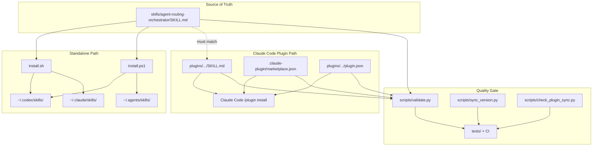

# Repository Structure

**Package:** `shared-agent-skills`  
**Version:** `0.5.0`  
**Role:** Structure Scout (1/5) — high-level layout, artifact map, and delivery paths  
**Last mapped:** 2026-06-22

## Purpose

This repository is a **portable agent-skill package**, not an application runtime. It ships one skill (`agent-routing-orchestrator`) through two installation channels:

1. **Standalone skill** — copied into user or project skill directories via install scripts or manual copy.
2. **Claude Code plugin** — installed from marketplace metadata under `.claude-plugin/` and `plugins/`.

Supporting assets include install scripts, user-facing docs, package metadata, and a Python validator that enforces structure, version alignment, and skill-copy parity.

There is no application entry point, server, build step, or vendored agent runtime. Executable logic lives under `scripts/` (validation, version sync, plugin sync checks) and is exercised by `tests/` and CI.

## Top-Level Tree

```text
shared-agent-skills/
├── .claude-plugin/
│   └── marketplace.json              # Claude Code marketplace manifest (1 plugin entry)
├── .github/
│   └── workflows/
│       ├── install-matrix.yml        # Cross-platform install script smoke tests
│       ├── release.yml               # Release automation
│       └── validate.yml              # validate.py, sync checks, pytest, ruff
├── .gitignore
├── .pre-commit-config.yaml           # Local hooks: validate, version sync, ruff
├── CHANGELOG.md                      # Release history
├── CODEGRAPH.md                      # Repo topology index (links to codegraph docs)
├── CONTRIBUTING.md                   # Pointer to docs/CONTRIBUTING.md
├── IMPLEMENTATION-PLAN.md          # Delivery roadmap index
├── LICENSE                           # MIT
├── README.md                         # Primary onboarding, install, usage summary
├── REVIEW-360.md                     # Governance review index
├── docs/
│   ├── CONTRIBUTING.md               # Dev setup, conventions, PR checklist
│   ├── DESIGN-PRINCIPLES.md          # Routing philosophy and design rationale
│   ├── USAGE.md                      # Extended usage examples and routing patterns
│   ├── codegraph/                    # Structure, dependencies, dataflow, components
│   ├── implementation-plan/          # Architecture, tooling, testing, docs, distribution
│   └── review-360/                   # Architecture, quality, testing, docs, distribution
├── install.ps1                       # Windows/PowerShell standalone installer
├── install.sh                        # macOS/Linux standalone installer
├── openpackage.yml                   # OpenPackage manifest (version + includes)
├── plugins/
│   └── agent-routing-orchestrator/
│       ├── .claude-plugin/
│       │   └── plugin.json           # Per-plugin Claude Code metadata
│       └── skills/
│           └── agent-routing-orchestrator/
│               └── SKILL.md          # Plugin copy (must match standalone)
├── pyproject.toml                    # Dev deps (pytest, ruff), tool config
├── scripts/
│   ├── check_plugin_sync.py          # Standalone vs plugin SKILL.md diff check
│   ├── sync_version.py               # Bump or verify four version sources
│   └── validate.py                   # Package structure and drift validator
├── skills/
│   └── agent-routing-orchestrator/
│       ├── SKILL.md                  # Source of truth for skill content
│       └── examples/                 # Prompt templates and routing examples
└── tests/
    ├── conftest.py
    ├── test_install_scripts.py
    ├── test_plugin_sync.py
    ├── test_sync_version.py
    └── test_validate.py
```

**File count (excluding `.git`):** 73 tracked artifacts across 12 logical areas.

## Artifact Map

| Path | Type | Role |
|---|---|---|
| `skills/agent-routing-orchestrator/SKILL.md` | Skill spec | **Source of truth** — routing contract, playbooks, session-log rules |
| `plugins/.../SKILL.md` | Skill spec | **Plugin mirror** — byte-identical copy for Claude Code plugin install |
| `.claude-plugin/marketplace.json` | JSON manifest | Registers marketplace name and single plugin source path |
| `plugins/.../.claude-plugin/plugin.json` | JSON manifest | Plugin identity, version, keywords, repository links |
| `openpackage.yml` | Package manifest | OpenPackage name/version and distributable include globs |
| `install.sh` / `install.ps1` | Shell scripts | Copy standalone skill into host skill directories; remove legacy skills |
| `scripts/validate.py` | Python CLI | Enforces naming, frontmatter, version sync, copy parity, forbidden content |
| `scripts/sync_version.py` | Python CLI | Sets or verifies semver across all four version-bearing artifacts |
| `scripts/check_plugin_sync.py` | Python CLI | Diff check between standalone and plugin `SKILL.md` copies |
| `tests/` | Python tests | pytest coverage for validators, sync scripts, and install scripts |
| `.github/workflows/` | CI | validate, install-matrix, and release pipelines |
| `.pre-commit-config.yaml` | Git hooks | Local validate, version sync, ruff before commit |
| `pyproject.toml` | Python packaging | Dev dependencies and pytest/ruff configuration |
| `CHANGELOG.md` | Documentation | Release notes |
| `CODEGRAPH.md` / `REVIEW-360.md` / `IMPLEMENTATION-PLAN.md` | Documentation | Governance and architecture indexes |
| `CONTRIBUTING.md` / `docs/CONTRIBUTING.md` | Documentation | Contributor onboarding and PR checklist |
| `README.md` | Documentation | Quick start, install paths, routing contract template, session-log format |
| `docs/USAGE.md` | Documentation | Detailed prompts, workflow tables, installation choices |
| `docs/DESIGN-PRINCIPLES.md` | Documentation | Core principles: lead-first, verify-before-complete, explicit review |
| `LICENSE` | Legal | MIT |

## Delivery Model

The same skill content is published through parallel paths. Standalone install never touches plugin metadata; plugin install never requires the install scripts.



### Standalone install targets

Both installers copy from `skills/` and accept a target argument:

| Target | Destination(s) |
|---|---|
| `codex` | `$CODEX_HOME/skills` (default `~/.codex/skills`) |
| `claude` | `$CLAUDE_HOME/skills` (default `~/.claude/skills`) |
| `agents` | `$AGENTS_HOME/skills` (default `~/.agents/skills`) |
| `both` | Codex + Claude user skill dirs |
| `all` | Codex + Claude + `.agents` user skill dirs |

Installers also **remove legacy skills** that were superseded by the merge into `agent-routing-orchestrator`:

- `cost-aware-delegation`
- `cross-agent-project-lead`

### Claude Code plugin path

Marketplace entry in `.claude-plugin/marketplace.json`:

- Marketplace name: `shared-agent-skills`
- Plugin name: `agent-routing-orchestrator`
- Plugin source: `./plugins/agent-routing-orchestrator`

The plugin directory is intentionally minimal. Validation forbids extra runtime directories under the plugin root:

`agents`, `commands`, `hooks`, `prompts`, `schemas`, `scripts`

## Skill Content Structure

`SKILL.md` is a Markdown file with YAML frontmatter. Current frontmatter fields:

| Field | Value / constraint |
|---|---|
| `name` | `agent-routing-orchestrator` — must match folder name |
| `description` | Trigger text for skill discovery (≤ 1024 chars) |
| `license` | `MIT` |
| `metadata.shared-agent-skills.version` | Package version (`0.5.0`) |

Body sections (in order):

1. **Gaps This Skill Closes** — rationale for merged skill
2. **Start With A Routing Contract** — normalized host/lead/review/execution fields
3. **Readiness Check** — verify tools/CLI/auth before routing externally
4. **Recommended Defaults** — situation → lead/executor/review table
5. **Hosting Profiles** — single session, subagents, remote/async, human-managed multi-chat
6. **Cost And Quality Tiers** — `cheap-fast`, `standard`, `frontier`
7. **Decision Modes** — single lead, lead-and-implementer, co-lead council
8. **Review And Rescue Playbooks** — review, challenge, handoff, background, resume
9. **Session Log** — required in-session logging format and events
10. **Context Packet** — ≤ 300 word delegation template
11. **Completion Packet** — executor return format
12. **Stop Rules** — escalation triggers
13. **Final Integration** — acceptance verification before success

**Size limits enforced by validator:**

- `SKILL.md` body: ≤ 500 lines
- Skill `name`: lowercase alphanumeric + hyphens, 1–64 chars, no consecutive hyphens

## Version Synchronization

Four version-bearing artifacts must stay aligned at `0.5.0`:

| Artifact | Location |
|---|---|
| Skill frontmatter | `metadata.shared-agent-skills.version` in both `SKILL.md` copies |
| Marketplace plugin entry | `.claude-plugin/marketplace.json` → `plugins[0].version` |
| Plugin manifest | `plugins/.../plugin.json` → `version` |
| OpenPackage manifest | `openpackage.yml` → `version` |

`scripts/validate.py` fails if any version differs or if the plugin skill copy drifts from the standalone source.

## Validation Contract

Run from repo root:

```bash
python scripts/validate.py
```

The validator checks:

- `skills/` exists; each skill dir has `SKILL.md` with valid frontmatter
- Skill folder name matches frontmatter `name`
- Plugin skill copy is byte-identical to standalone skill
- No forbidden plugin subdirectories
- Marketplace and plugin JSON names/sources match expectations
- All four version fields match
- Required root files exist: `README.md`, `LICENSE`, `install.ps1`, `install.sh`, `openpackage.yml`
- No forbidden text patterns (legacy package references, vendor-specific URLs, etc.) anywhere in tracked files

## Documentation Layer

| Document | Audience | Scope |
|---|---|---|
| `README.md` | New users | Install, quick prompts, routing contract template, package layout summary |
| `docs/USAGE.md` | Practitioners | Full routing contracts, workflow-specific prompts, session-log examples |
| `docs/DESIGN-PRINCIPLES.md` | Maintainers / reviewers | Why the package exists; decision vs execution separation |
| `docs/CONTRIBUTING.md` | Contributors | Dev setup, skill conventions, validation troubleshooting, PR checklist |
| `CHANGELOG.md` | Users / maintainers | Release history |
| `CODEGRAPH.md` | Agents / maintainers | Index into `docs/codegraph/` topology docs |
| `REVIEW-360.md` / `IMPLEMENTATION-PLAN.md` | Maintainers | Governance reviews and delivery roadmap |
| `docs/codegraph/01-structure.md` | Agents / maintainers | Repo topology and artifact relationships (this file) |

User-facing docs describe *how to use* the skill. This codegraph doc describes *how the repo is organized*.

## Extension Points and Constraints

**Safe to extend:**

- Add new skills under `skills/<skill-name>/SKILL.md` (validator iterates all skill dirs)
- Expand `docs/` with additional guides
- Add matching plugin entries if the marketplace model grows (today: exactly one plugin enforced)

**Constrained by design:**

- Plugin skill copy must remain identical to standalone source — edit `skills/.../SKILL.md` first, then sync plugin copy
- Plugin root must not accumulate command/runtime assets (forbidden dirs list in validator)
- Version bumps must touch all four version locations atomically
- Package remains project-agnostic — no repo-specific paths, credentials, or vendored agent runtimes

**Not present (by design):**

- Application source code / modules beyond validation tooling
- Vendored agent runtimes or bundled CLIs
- Runtime dependency manifests for end users — Python 3 stdlib for scripts; dev deps in `pyproject.toml` only

## Dependency Surface

| Dependency | Required for | Notes |
|---|---|---|
| Git | Clone/distribute | Repository delivery |
| Python 3.11+ | Scripts, tests, pre-commit | Stdlib for runtime scripts; pytest/ruff via `pyproject.toml` dev extras |
| pre-commit | Optional local hooks | Runs validate, sync checks, ruff before commit |
| Agent host with skills or Claude plugins | Runtime use | Codex, Claude Code, `.agents`, or project-local skill dirs |
| External agents/CLIs | Routed work | Not bundled; skill selects routes only |

## Quick Reference for Downstream Scouts

| Question | Answer |
|---|---|
| Where is the canonical skill? | `skills/agent-routing-orchestrator/SKILL.md` |
| Where is the plugin copy? | `plugins/agent-routing-orchestrator/skills/agent-routing-orchestrator/SKILL.md` |
| How do users install standalone? | `install.sh` / `install.ps1` → host skill directories |
| How do Claude Code users install? | Marketplace + `/plugin install agent-routing-orchestrator@shared-agent-skills` |
| What enforces consistency? | `scripts/validate.py`, `scripts/sync_version.py`, `scripts/check_plugin_sync.py`, `tests/`, CI |
| What is the runtime code? | `scripts/` validators + `tests/` (no application server) |
| Current package version? | `0.5.0` |

## Related Paths for Later Codegraph Docs

Suggested follow-on scouts (2/5–5/5) may drill into:

- **Skill semantics** — routing contract fields, playbooks, stop rules (content of `SKILL.md`)
- **Install flow** — script behavior, env vars, legacy cleanup, target matrix
- **Plugin/marketplace schema** — JSON fields, Claude Code install lifecycle
- **Validation rules** — full rule set, forbidden patterns, failure modes
