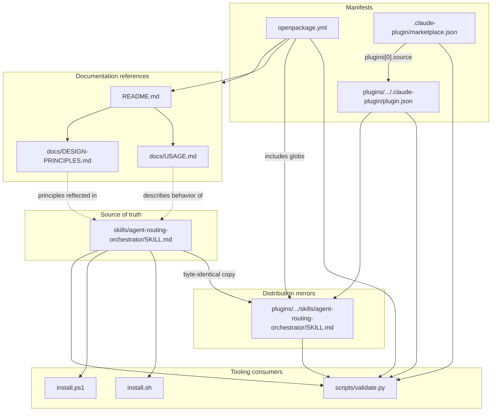
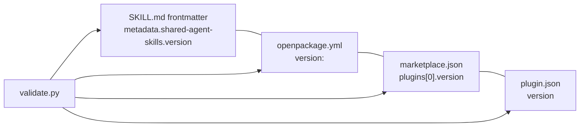
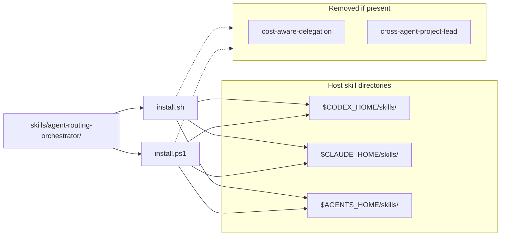
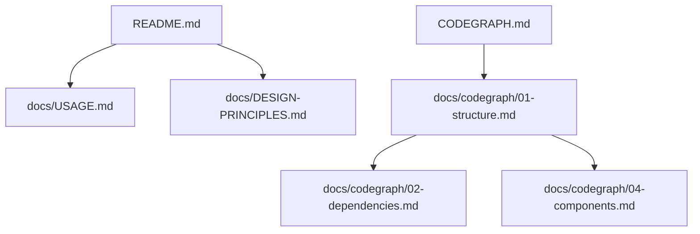
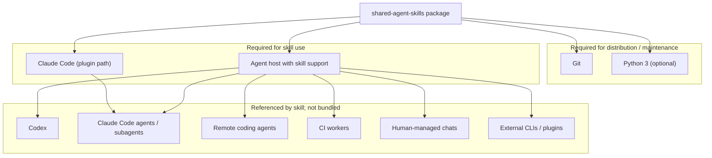
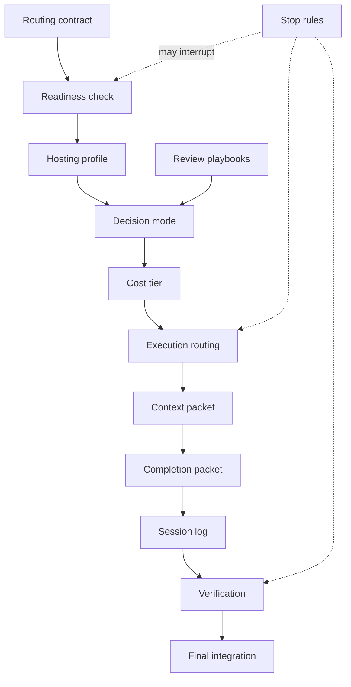

# Dependencies — shared-agent-skills

**Package:** `shared-agent-skills`  
**Version:** `0.5.0`  
**Role:** Dependency Mapper (2/5) — internal artifact coupling, external requirements, and version sync  
**Last mapped:** 2026-06-21

## Overview

This repository has **no application modules, package managers, or runtime libraries**. Dependencies fall into three layers:

1. **Internal artifact dependencies** — which files must stay aligned, reference each other, or are copied from a single source of truth.
2. **Build/tooling dependencies** — Python stdlib for validation; shell/PowerShell for install scripts.
3. **External/runtime dependencies** — agent hosts, Claude Code plugin infrastructure, Git, and the external agents the skill routes to (not bundled).

There are no `package.json`, `requirements.txt`, `Cargo.toml`, or similar dependency manifests. The only Python code is `scripts/validate.py`, which uses the standard library exclusively.

---

## Internal Dependency Graph

All deliverable content ultimately depends on one canonical skill file. Packaging, validation, and install paths fan out from it.



### Dependency rules

| Dependent | Depends on | Coupling type | Failure mode if broken |
|---|---|---|---|
| Plugin skill copy | Standalone `skills/.../SKILL.md` | Byte identity | `validate.py` fails on drift |
| `install.sh` / `install.ps1` | `skills/agent-routing-orchestrator/` | Filesystem copy | Install copies stale or missing skill |
| `marketplace.json` | `./plugins/agent-routing-orchestrator` | Path reference | Claude Code plugin install breaks |
| `plugin.json` | Plugin skill tree under `plugins/.../skills/` | Directory layout | Plugin discovery fails |
| `openpackage.yml` | Plugin tree, `README.md`, `docs/**` | Include globs | OpenPackage distribution incomplete |
| `validate.py` | All of the above + root required files | Validation contract | Release blocked (exit code 1) |
| User docs | Skill semantics in `SKILL.md` | Conceptual | Docs/skill behavior mismatch (not auto-checked) |

---

## Version Synchronization Chain

Four artifacts carry the package version (`0.5.0`). They form a **hard sync group** enforced by `validate.py`:



| Version field | File | Path / key |
|---|---|---|
| Skill metadata | `skills/.../SKILL.md` | `metadata.shared-agent-skills.version` |
| Skill metadata (mirror) | `plugins/.../SKILL.md` | Same frontmatter (identical file) |
| OpenPackage | `openpackage.yml` | `version:` |
| Marketplace | `.claude-plugin/marketplace.json` | `plugins[0].version` |
| Plugin manifest | `plugins/.../plugin.json` | `version` |

Any single-field bump without updating all four causes validation failure.

---

## Python Tooling Dependencies

### `scripts/validate.py`

The only executable code in the repo. **No third-party packages.**

| Import | Module | Used for |
|---|---|---|
| `__future__.annotations` | stdlib | Forward-compatible type hints |
| `re` | stdlib | Skill name regex, version line parsing, forbidden pattern checks |
| `sys` | stdlib | Exit codes |
| `json` | stdlib | `marketplace.json`, `plugin.json` parsing |
| `pathlib.Path` | stdlib | Repo-root-relative file traversal |

**Runtime requirement:** Python 3 (any recent 3.x with `pathlib` and `dict[str, str]` support).

**Filesystem dependencies read by `main()`:**

| Path / pattern | Purpose |
|---|---|
| `skills/*/SKILL.md` | Frontmatter, naming, line limits, version metadata |
| `plugins/.../skills/.../SKILL.md` | Drift check vs standalone |
| `plugins/agent-routing-orchestrator/{agents,commands,hooks,prompts,schemas,scripts}/` | Must **not** exist |
| `.claude-plugin/marketplace.json` | Marketplace name, plugin count, source path |
| `plugins/.../.claude-plugin/plugin.json` | Plugin name |
| `openpackage.yml` | Package version |
| `ROOT.rglob("*")` (excluding `.git`) | Forbidden text pattern scan |
| `README.md`, `LICENSE`, `install.ps1`, `install.sh`, `openpackage.yml` | Required root files |

---

## Install Script Dependencies

Both installers share the same logical dependency surface; they differ only by shell runtime.



| Script | Shell dependency | Env vars | Source path | Output |
|---|---|---|---|---|
| `install.sh` | POSIX `sh` (`cp`, `rm`, `mkdir`) | `CODEX_HOME`, `CLAUDE_HOME`, `AGENTS_HOME` (optional) | `skills/agent-routing-orchestrator` | Host skill dirs |
| `install.ps1` | PowerShell 5+ | Same via params or defaults | Same | Same |

Default host paths when env vars are unset:

| Variable | Unix default | Windows default |
|---|---|---|
| `CODEX_HOME` | `~/.codex` | `%USERPROFILE%\.codex` |
| `CLAUDE_HOME` | `~/.claude` | `%USERPROFILE%\.claude` |
| `AGENTS_HOME` | `~/.agents` | `%USERPROFILE%\.agents` |

Install scripts do **not** depend on Python, Node, or plugin metadata. They only copy the standalone skill tree.

---

## Plugin & Packaging Dependencies

### Claude Code marketplace

`marketplace.json` declares an external schema dependency (documentation/validation only — not fetched at runtime by this repo):

```json
"$schema": "https://anthropic.com/claude-code/marketplace.schema.json"
```

| Field | Value | Depends on |
|---|---|---|
| `name` | `shared-agent-skills` | — |
| `plugins[0].name` | `agent-routing-orchestrator` | Matches skill folder and `plugin.json` |
| `plugins[0].source` | `./plugins/agent-routing-orchestrator` | Plugin directory layout |
| `plugins[0].version` | `0.5.0` | Version sync group |

### OpenPackage

| `openpackage.yml` key | Includes | Depends on |
|---|---|---|
| `includes` | `plugins/agent-routing-orchestrator/**/*` | Full plugin tree |
| `includes` | `README.md` | Root readme |
| `includes` | `docs/**/*` | Documentation tree |

OpenPackage does **not** include standalone `skills/`, install scripts, or `scripts/validate.py` in its include globs — those are repo-local maintainer assets, not the OpenPackage bundle surface.

---

## Documentation Cross-References

User-facing docs form a shallow reference graph (no build-time coupling):



| Document | References | Referenced by |
|---|---|---|
| `README.md` | `docs/USAGE.md`, `docs/DESIGN-PRINCIPLES.md`, skill name, install commands | `openpackage.yml` includes |
| `docs/USAGE.md` | `agent-routing-orchestrator`, GitHub clone URL, `.planning/AGENT-SESSION-LOG.md` (optional user path) | `README.md` |
| `docs/DESIGN-PRINCIPLES.md` | Routing principles embodied in skill | `README.md` |
| `CODEGRAPH.md` | Synthesizes structure, install, validation, external integrations | Maintainers |

Neither docs nor `CODEGRAPH.md` are validated for link integrity by `validate.py`.

---

## Legacy Skill Dependencies (Migration)

The current skill **supersedes** two legacy skills. Install scripts treat them as negative dependencies — removed on install if found:

| Legacy skill | Relationship to current package | Action on install |
|---|---|---|
| `cost-aware-delegation` | Merged into `agent-routing-orchestrator` | `rm -rf` from target skill dir |
| `cross-agent-project-lead` | Merged into `agent-routing-orchestrator` | Same |

The skill body documents five gaps closed by this merge (unified routing contract, host-aware routing, combined cost/review guidance, session logging, legacy cleanup). There is **no runtime import** between legacy and current skills — only install-time cleanup.

---

## External Runtime Dependencies

These are required or referenced **outside** the repository. None are vendored or pinned by a manifest in this repo.



### External dependency table

| Dependency | Required when | Version pinning | Notes |
|---|---|---|---|
| **Git** | Clone, fork, publish | None | Primary distribution channel |
| **Python 3** | Running `validate.py` | None | Stdlib only; not needed for install or skill use |
| **POSIX shell** | Running `install.sh` | None | `sh`-compatible |
| **PowerShell** | Running `install.ps1` | None | Windows installer |
| **Codex skill host** | Standalone install → `~/.codex/skills/` | Host-managed | Skill loaded by description frontmatter |
| **Claude skill host** | Standalone install → `~/.claude/skills/` | Host-managed | Same skill content |
| **`.agents` skill host** | `install ... all` | Host-managed | Cross-tool skill directory convention |
| **Claude Code plugin system** | Marketplace install path | Host-managed | Uses `marketplace.json` + `plugin.json` |
| **Anthropic marketplace schema** | JSON authoring reference | URL in `$schema` | Not fetched by repo scripts |
| **GitHub** | Clone URL, plugin homepage | `ramsaijanapana/shared-agent-skills` | Listed in manifests and README |
| **External agents / CLIs** | When skill routes work | User-installed | Readiness check verifies availability; skill does not invoke APIs |

### Forbidden external couplings

`validate.py` scans the entire repo (excluding `.git`) and **rejects** text patterns that imply dependency on unrelated packages. See `FORBIDDEN_TEXT_PATTERNS` in `scripts/validate.py` for the exact substrings (legacy Codex plugin naming, external skill registries, vendor GitHub URLs, design-inspiration boilerplate, etc.). Do not duplicate those literals in documentation.

This keeps the package **self-contained** and project-agnostic.

---

## Skill Semantic Dependencies (Conceptual)

The skill markdown defines logical dependencies between workflow concepts. These are not code imports but govern runtime behavior when a host loads the skill:



| Concept | Depends on | Produces |
|---|---|---|
| Routing contract | User prompt / inferred defaults | Normalized host, lead, review, execution fields |
| Readiness check | Named route in contract | Proceed or fallback recommendation |
| Hosting profile | Host type | Lead/executor/reviewer defaults |
| Decision mode | Risk and ambiguity | Single lead, lead+implementer, or co-lead council |
| Cost tier | Task type and risk | `cheap-fast`, `standard`, or `frontier` selection |
| Context packet | Delegation decision | ≤300-word worker handoff |
| Completion packet | Executor work | Evidence for lead verification |
| Session log | All decision points | Audit trail in active session |
| Verification | Completion evidence | `complete`, `partial`, or `blocked` status |

Optional durable log path (`.planning/AGENT-SESSION-LOG.md`) is **user/project-provided** — not a repo dependency.

---

## Dependency Summary Matrix

| Layer | Count | Pinned manifest | Auto-validated |
|---|---|---|---|
| Internal artifacts | 13 tracked files | No | Yes (`validate.py`) |
| Python third-party packages | 0 | — | — |
| Python stdlib modules | 5 | — | Implicit |
| Version sync fields | 4 (1 logical) | Hard-coded in files | Yes |
| Legacy skills (removed) | 2 | — | Install scripts only |
| External agent hosts | 3+ conventions | — | No |
| External routed agents | Open set | — | Readiness check at runtime |

---

## Quick Reference for Downstream Scouts

| Question | Answer |
|---|---|
| Canonical dependency root? | `skills/agent-routing-orchestrator/SKILL.md` |
| What must stay byte-identical? | Plugin `SKILL.md` copy |
| What enforces coupling? | `scripts/validate.py` |
| Any npm/pip/cargo deps? | None |
| Python packages needed? | None (stdlib only for validation) |
| What do install scripts need? | Shell + `skills/` directory only |
| What does the skill need at runtime? | Agent host; external agents user already installed |
| Legacy deps to clean up? | `cost-aware-delegation`, `cross-agent-project-lead` on install targets |
| Version bump touch list? | Skill frontmatter, `openpackage.yml`, `marketplace.json`, `plugin.json` |

## Related Codegraph Docs

| Doc | Focus |
|---|---|
| [01-structure.md](./01-structure.md) | Directory layout, delivery paths, artifact map |
| [03-dataflow.md](./03-dataflow.md) | Install, validation, and skill invocation flows |
| [04-components.md](./04-components.md) | Component catalog, contracts, validation functions |
| [../../CODEGRAPH.md](../../CODEGRAPH.md) | Master synthesis |
