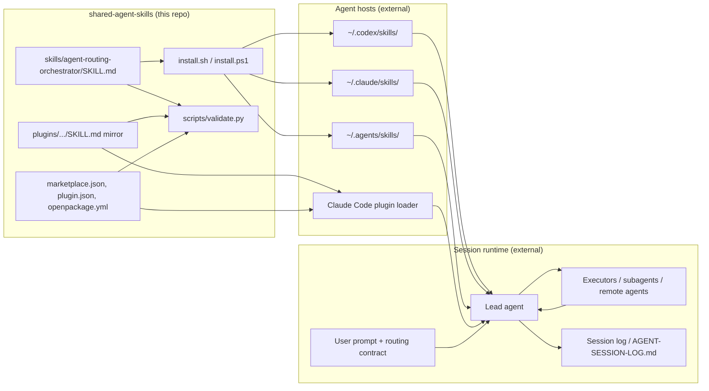
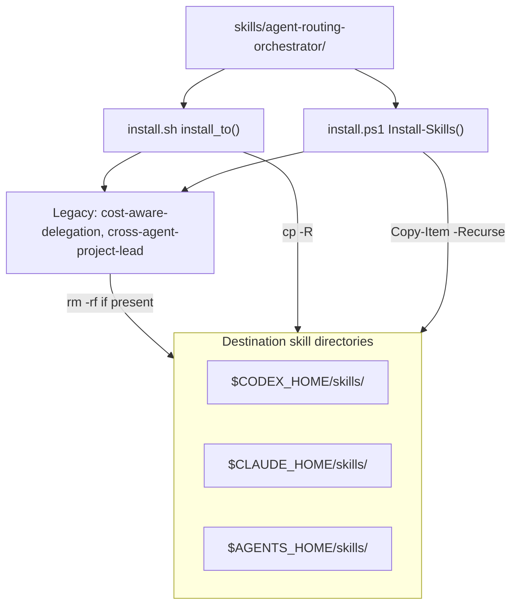
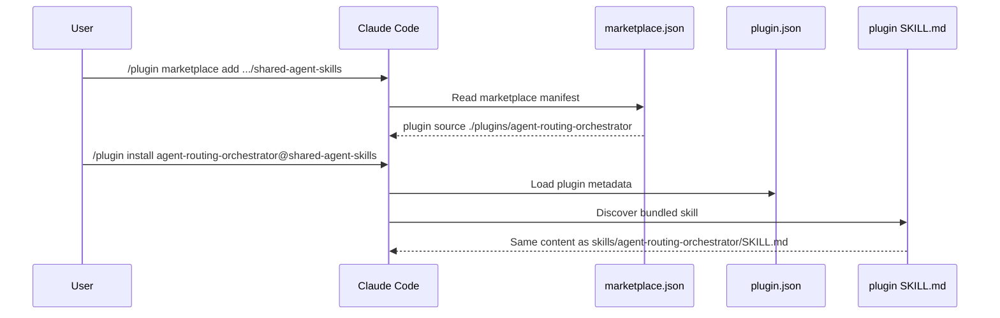
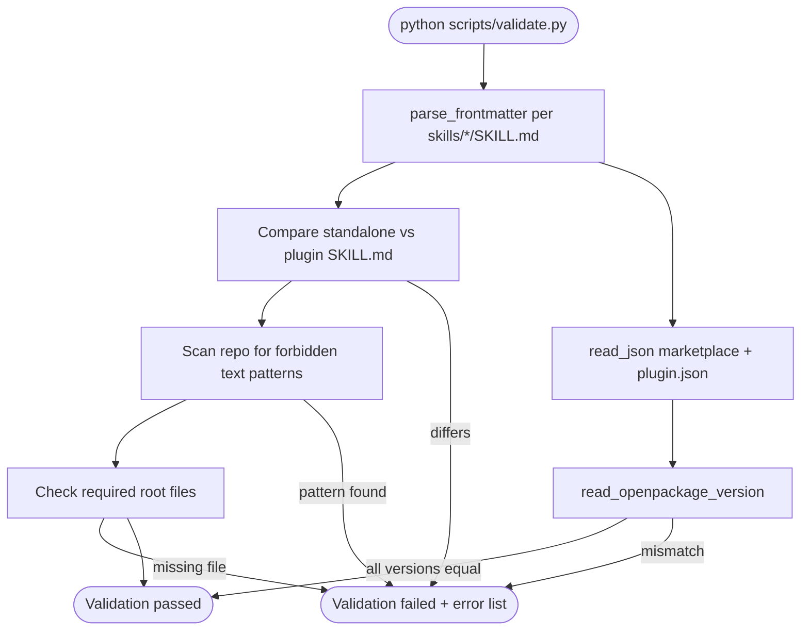
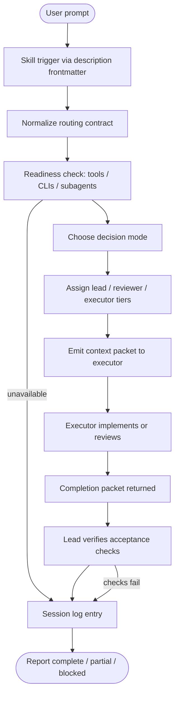
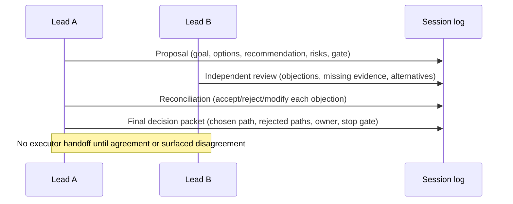
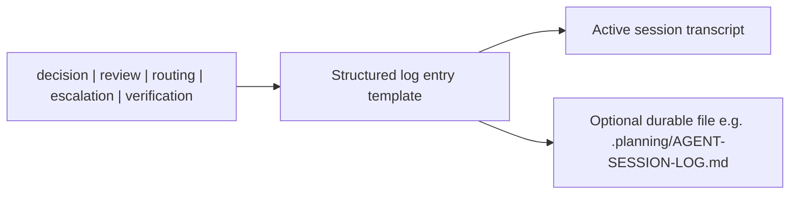
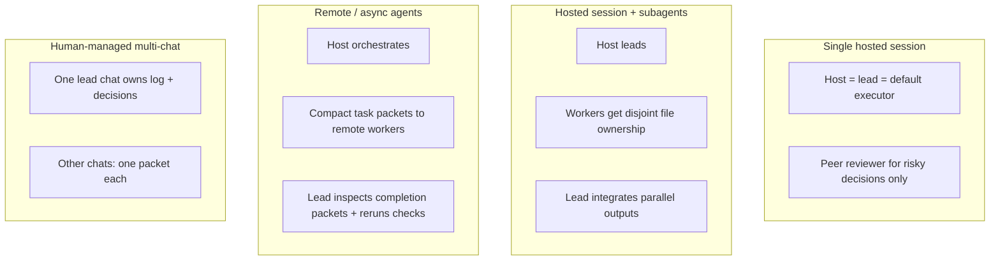
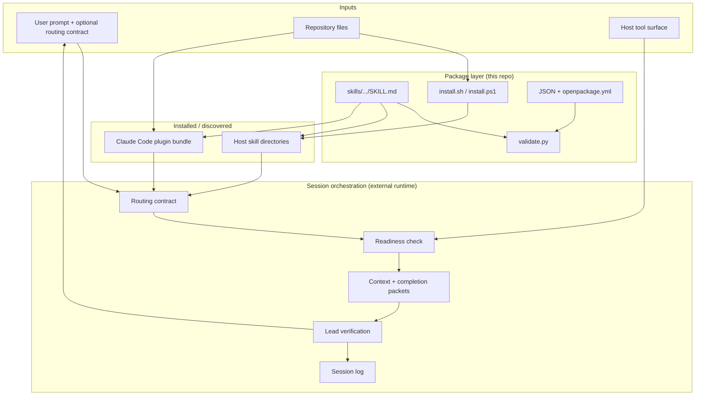

# Data Flow — `shared-agent-skills`

## Summary

`shared-agent-skills` is **not a runtime application**. It is a **portable skill and plugin package** that instructs AI agent hosts how to route work across leads, reviewers, and executors. There is no server, database, or long-lived process in this repo.

Data movement falls into three lanes:

1. **Distribution** — skill files and metadata move from this repo into agent host skill directories or Claude Code plugin discovery paths.
2. **Orchestration** — at session time, the host agent transforms user intent into a routing contract, context/completion packets, and session log entries (all text, in-chat or in a durable file).
3. **Integrity** — `scripts/validate.py` reads package files and enforces structural, version, and copy-sync invariants before release.

The canonical behavioral spec lives in `skills/agent-routing-orchestrator/SKILL.md`. Everything else is packaging, installation, or verification around that single skill.

---

## Repository role in the wider system



| Location | Role |
|----------|------|
| `skills/agent-routing-orchestrator/SKILL.md` | **Source of truth** for routing behavior, packet shapes, and log format |
| `plugins/agent-routing-orchestrator/skills/.../SKILL.md` | Plugin-installable copy; must byte-match standalone skill |
| `install.sh` / `install.ps1` | Copy skill tree to user skill dirs; remove legacy merged skills |
| `.claude-plugin/marketplace.json` | Claude Code marketplace entry pointing at plugin directory |
| `plugins/.../.claude-plugin/plugin.json` | Plugin manifest for Claude Code |
| `openpackage.yml` | Package metadata for OpenPackage distribution |
| `scripts/validate.py` | Pre-release gate: structure, versions, forbidden text, skill sync |
| External agent hosts | Load skill by `description` frontmatter trigger; execute routing playbooks in-session |

---

## External data sources

This package consumes **no external APIs or databases**. Inputs are:

| Source | Format | Consumed by | Purpose |
|--------|--------|-------------|---------|
| User prompt | Plain text in chat | Host agent + skill | Routing contract fields, goal, constraints |
| Host tool surface | Implicit (plugins, subagents, CLIs) | Lead agent (`Readiness Check` in SKILL.md) | Verify executors exist before routing |
| Project artifacts | File paths, diffs, test output | Lead + executors | Context pointers, acceptance checks, verification evidence |
| Optional durable log | Markdown file (e.g. `.planning/AGENT-SESSION-LOG.md`) | Lead agent | Long-running decision/review history |

There are no secrets, credentials, or production data flows defined in-repo. The skill explicitly lists credentials and production data under `Do not touch`.

---

## Distribution pipeline

### Path A — Standalone install (Codex / Claude / `.agents`)



**Install script data flow** (`install.sh` / `install.ps1`):

| Step | Function | Input | Output |
|------|----------|-------|--------|
| 1 | `install_to()` / `Install-Skills()` | `$ROOT/skills/agent-routing-orchestrator/` | Target skill directory tree |
| 2 | Legacy cleanup | Known legacy skill names | Removed directories under each target |
| 3 | Fresh copy | Source skill folder | `agent-routing-orchestrator/SKILL.md` at host path |

**Target selection** (`install.sh` case / `install.ps1 -Target`):

| Target | Destinations |
|--------|--------------|
| `codex` | `$CODEX_HOME/skills` (default `~/.codex/skills`) |
| `claude` | `$CLAUDE_HOME/skills` (default `~/.claude/skills`) |
| `agents` | `$AGENTS_HOME/skills` (default `~/.agents/skills`) |
| `both` | Codex + Claude |
| `all` | Codex + Claude + `.agents` |

### Path B — Claude Code plugin install



Plugin path does **not** run `install.sh`. Claude Code reads files in-place from the cloned repo (or installed plugin bundle).

---

## Validation pipeline



**Key functions** in `scripts/validate.py`:

| Function | Reads | Produces / checks |
|----------|-------|-------------------|
| `parse_frontmatter(path)` | `SKILL.md` YAML fence | `name`, `description`, `shared-agent-skills.version`, nested `metadata` |
| `read_json(path, errors)` | JSON manifests | Parsed dict; appends to `errors` on failure |
| `read_openpackage_version(errors)` | `openpackage.yml` | `version:` field |
| `main()` | Entire repo tree | Exit 0 or 1; prints error list |

**Version sync chain** (must all match, currently `0.5.0`):

```
openpackage.yml:version
  ↔ SKILL.md metadata.shared-agent-skills.version
  ↔ marketplace.json plugins[0].version
  ↔ plugin.json version
```

**Structural invariants enforced:**

- `skills/<name>/SKILL.md` frontmatter `name` matches directory name
- Skill name regex: lowercase alphanumeric + hyphens, 1–64 chars
- `description` required, ≤ 1024 chars; body ≤ 500 lines
- Plugin skill copy **byte-identical** to standalone
- No forbidden plugin subdirs: `agents`, `commands`, `hooks`, `prompts`, `schemas`, `scripts`
- Required root files: `README.md`, `LICENSE`, `install.ps1`, `install.sh`, `openpackage.yml`

---

## Session orchestration pipeline

When a user invokes the skill, the host agent follows the playbook in `SKILL.md`. This is the primary **runtime data flow** — entirely conversational/textual.



### Stage 1 — Skill discovery

```
User message containing routing/delegation/host keywords
  → Host skill loader matches description frontmatter
  → skills/agent-routing-orchestrator/SKILL.md loaded into context
```

Trigger phrases are defined in frontmatter `description` (e.g. cost-aware delegation, agent routing, session logs, verification preferences).

### Stage 2 — Routing contract normalization

User-provided or inferred fields (from `SKILL.md` § "Start With A Routing Contract"):

| Field | Type | Default / inference behavior |
|-------|------|----------------------------|
| `Host` | enum-like label | Codex, Claude Code, remote agent, CI, human multi-chat |
| `Lead` | agent role | Host agent or highest-quality available |
| `Review` | reviewer role | Peer, co-lead council, human, or none |
| `Execution` | executor surface | Local, subagents, remote agents, CI, human-assigned |
| `Cost mode` | `quality-first` \| `balanced` \| `budget` | Influences tier selection |
| `Autonomy` | `autonomous` \| `ask-on-stop-rules` \| `manual` | Stop-rule gates |
| `Manual review` | trigger list | Destructive edits, data, licensing, spend, etc. |
| `Context limit` | word count | Default 300 per worker packet |
| `Session log` | destination | Chat only, file path, or both |
| `Verification` | check types | Tests, diffs, screenshots, acceptance criteria |
| `Do not touch` | scope denylist | Files, credentials, production data |

Output: a **normalized routing contract** stated in the session (logged as `routing` event).

### Stage 3 — Readiness check

Before routing to a named external agent, CLI, plugin, subagent, or background worker:

```
Requested route (e.g. "Claude subagents", "remote coding agent")
  → Cheap availability probe (installed? on PATH? auth? workspace visible?)
  → If unavailable: log limitation + recommend fallback
  → Never invent slash commands or controls the host lacks
```

### Stage 4 — Decision mode selection

| Mode | When | Data exchanged |
|------|------|----------------|
| Single lead | Reversible, explicit requirements | Lead decides, executes, verifies, logs |
| Lead and implementer | Clear direction, bounded execution | Context packet → completion packet |
| Co-lead council | Architecture, security, data, expensive work | Proposal → objections → reconciliation → decision packet |

Co-lead council flow:



### Stage 5 — Cost / quality tier routing

| Tier | Routed work | Not routed work |
|------|-------------|-----------------|
| `cheap-fast` | Status checks, narrow doc edits, formatting, grep summaries | Ambiguity, irreversible edits |
| `standard` | Bounded implementation, bugfixes, targeted tests | Architecture, security, product direction |
| `frontier` | Architecture, hard debugging, review gates, data integrity | Routine edits |

Escalation rule: if cheap tier fails from missing context → improve packet once; if reasoning exceeded tier → escalate.

### Stage 6 — Context packet (lead → executor)

Default ≤ 300 words. Schema from `SKILL.md` § "Context Packet":

```text
Goal + non-goals
Files or areas to read/edit
Do-not-touch list
Constraints and invariants
Acceptance checks
Expected output format
Escalation triggers
Artifact pointers (paths, commits) — not full logs
```

### Stage 7 — Completion packet (executor → lead)

Required return shape from `SKILL.md` § "Completion Packet":

| Field | Values / content |
|-------|------------------|
| `Result` | `complete` \| `partial` \| `blocked` |
| Files changed or inspected | Path list |
| Tests / checks run | Commands + outcomes |
| Risks / assumptions / open questions | Free text |
| Commit hash or patch summary | If applicable |
| Next action if blocked | Exact instruction |

Worker-reported checks are **evidence only**; lead must independently verify.

### Stage 8 — Verification and final integration

```
Lead inspects smallest relevant diff/artifact
  → Reruns smallest sufficient acceptance checks
  → Updates session log (verification entry)
  → Reports outcome: complete | partial | blocked
```

Stop rules (pause/escalate) include: conflicting requirements, unavailable agents, out-of-scope file touches, architecture changes, missing probe gates, co-lead disagreement, un runnable checks when completion expected.

---

## Session log data flow



**Log entry schema** (from `SKILL.md` and `docs/USAGE.md`):

```text
[time] decision|review|routing|escalation|verification
Context: one sentence.
Recommendation: chosen path or verdict.
Reason: key evidence or tradeoff.
Owner: lead/reviewer/executor.
Next: immediate action or stop gate.
```

**Events that must be logged:**

- Routing contract and inferred defaults
- Lead, co-lead, reviewer, executor choices
- Co-lead proposals, objections, reconciliations, final decisions
- Review verdicts and required changes
- Escalations, blocked states, manual-review triggers
- Verification commands, outcomes, acceptance decisions

Routine execution may be batched; high-risk decisions logged individually.

---

## Key data artifacts

| Artifact | Format | Producer | Consumer | Persistence |
|----------|--------|----------|----------|-------------|
| `SKILL.md` | Markdown + YAML frontmatter | Maintainers | Agent hosts, validate.py | Git repo + installed copy |
| Routing contract | Plain text in chat | User + lead agent | Lead, reviewers, executors | Session (+ optional file) |
| Context packet | Plain text ≤300 words | Lead agent | Executor | Ephemeral handoff |
| Completion packet | Structured plain text | Executor | Lead agent | Session |
| Co-lead decision packet | Structured plain text | Co-leads | Lead, executors (after agreement) | Session (+ optional file) |
| Session log entry | Timestamped text block | Lead agent | User, future sessions | Chat / markdown file |
| `marketplace.json` | JSON | Maintainers | Claude Code | Git repo |
| `plugin.json` | JSON | Maintainers | Claude Code | Git repo |
| `openpackage.yml` | YAML | Maintainers | OpenPackage tooling | Git repo |
| Validation stdout | Text lines | `validate.py` | CI / maintainer | Transient |

### SKILL.md frontmatter fields

Parsed by `parse_frontmatter()`:

```yaml
name: agent-routing-orchestrator          # must match directory name
description: <trigger text, ≤1024 chars>
license: MIT
metadata:
  shared-agent-skills.version: "0.5.0"    # synced across manifests
```

---

## Key end-to-end data-flow paths

### Path 1 — Release integrity

```
Maintainer edits skills/agent-routing-orchestrator/SKILL.md
  → Copy/sync to plugins/.../SKILL.md
  → Bump version in openpackage.yml, marketplace.json, plugin.json, frontmatter
  → python scripts/validate.py
  → parse_frontmatter + byte compare + version equality + forbidden scan
  → "Validation passed." or error list
```

### Path 2 — User installs standalone skill

```
git clone shared-agent-skills
  → sh install.sh all  (or install.ps1 -Target all)
  → Remove legacy skills from each target
  → cp skills/agent-routing-orchestrator → ~/.codex/skills/, ~/.claude/skills/, ~/.agents/skills/
  → Host discovers skill on reload/restart
```

### Path 3 — Bounded implementation with subagent

```
User prompt with routing contract
  → Lead normalizes contract + logs routing
  → Readiness check: subagents available
  → Lead selects standard tier + lead-and-implementer mode
  → Context packet (goal, files, checks, stop rules) → subagent
  → Subagent returns completion packet
  → Lead verifies diff + runs acceptance checks
  → Session log: verification entry
  → User receives outcome + evidence
```

### Path 4 — Review before shipping

```
User: "review this branch before shipping"
  → Mode: review-only (no silent implementation)
  → Reviewer ≠ implementer when possible
  → Reviewer inspects files, returns findings + severity + verification gaps
  → Lead logs review verdict
  → Fixes routed as separate task if user approves
```

### Path 5 — Human-managed multi-chat

```
User designates one chat as lead
  → Lead maintains canonical session log
  → Other chats receive one bounded packet each (executor or reviewer role)
  → Completion/review packets return to lead chat
  → Lead integrates, verifies, records final decision
```

---

## Cross-boundary flows

| Boundary | Mechanism | Contract |
|----------|-----------|----------|
| Repo → Codex/Claude/`.agents` | File copy via install scripts | Full `agent-routing-orchestrator/` directory |
| Repo → Claude Code plugin | Marketplace + plugin manifest | Plugin-relative path to mirrored `SKILL.md` |
| Lead → subagent / remote agent | Context packet in host messaging | ≤300 words; artifact paths not full logs |
| Executor → lead | Completion packet | Result status + files + checks + risks |
| Lead → user | Session log + final report | Verification evidence required before "complete" |
| Co-lead A ↔ co-lead B | Proposal / objection / reconciliation packets | No executor handoff until agreement or escalation |
| Skill → durable log | Optional markdown file | Same entry format as in-session log |

There is **no** programmatic API between this repo and external agents. All cross-boundary data is **text and file artifacts** mediated by the host environment.

---

## Hosting profile data flows



| Profile | Lead data owner | Executor input | Integration point |
|---------|-----------------|----------------|-------------------|
| Single session | Host agent | User prompt + repo artifacts | Same session |
| Subagents | Host agent | Context packets | Host merges diffs |
| Remote/async | Interactive host | Task packets + probe gates | Host verifies artifacts |
| Human multi-chat | Designated lead chat | Bounded packets to other chats | Lead chat |

---

## Background / async processing

There is **no** internal job queue, worker pool, or scheduler in this repo.

- `validate.py` runs synchronously on demand.
- Install scripts run synchronously per target directory.
- Async remote/background work is **defined by the skill** as an external host capability: the lead may delegate to background agents only when status/result/cancel/resume controls exist (see `SKILL.md` review playbooks).

---

## Configuration affecting data flow

| Config | Location | Effect |
|--------|----------|--------|
| `CODEX_HOME` | Env var | Override default `~/.codex` install root |
| `CLAUDE_HOME` | Env var | Override default `~/.claude` install root |
| `AGENTS_HOME` | Env var | Override default `~/.agents` install root |
| `install.sh` target arg | CLI | Select which skill directories receive copy |
| `install.ps1 -Target` | CLI | Same as shell script targets |
| User routing contract | Chat prompt | Overrides skill defaults unless unsafe |
| `Context limit` in contract | Chat prompt | Overrides default 300-word packet cap |
| `Session log` in contract | Chat prompt | Chat-only vs durable file path |
| Version fields | `openpackage.yml`, JSON manifests, frontmatter | Must stay aligned for validation to pass |

---

## What this repo does **not** process

| Not present | Implication |
|-------------|-------------|
| Database or ORM | No persisted application state |
| HTTP server or webhooks | No inbound API data |
| Message queue | No async pipeline inside repo |
| Bundled agent runtime | Routing only; external agents must pre-exist |
| Generated code or migrations | Skill text is hand-maintained |
| Test suite (beyond validate.py) | Integrity checks are structural, not behavioral |

---

## Full system data-flow diagram



---

*Generated for codegraph role 3/5 (Data Flow Analyst). Primary behavioral source: `skills/agent-routing-orchestrator/SKILL.md`. Integrity source: `scripts/validate.py`. Install sources: `install.sh`, `install.ps1`.*
