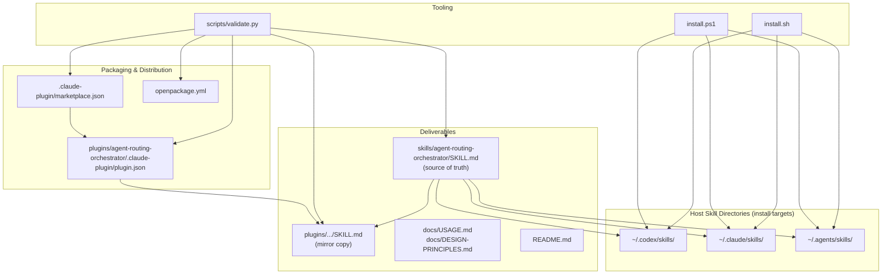
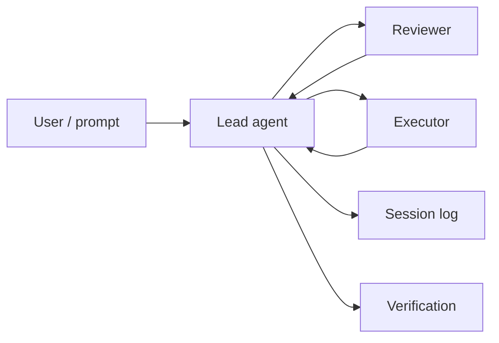

# Component Catalog — shared-agent-skills

This repository is a **portable skill and plugin package**, not an application runtime. Components are deliverable artifacts (skill, plugin metadata, install scripts, validation), logical skill modules defined in markdown, and the contracts those modules enforce.

**Package version:** `0.5.0` (kept in sync across `openpackage.yml`, skill frontmatter, marketplace, and plugin metadata)

---

## Component Map



---

## Key Files

| Path | Component type | Responsibility |
|------|----------------|----------------|
| `skills/agent-routing-orchestrator/SKILL.md` | Skill (source of truth) | Defines routing orchestration behavior, contracts, playbooks, and session-log rules consumed by agent hosts |
| `plugins/agent-routing-orchestrator/skills/agent-routing-orchestrator/SKILL.md` | Skill (plugin mirror) | Byte-identical copy for Claude Code plugin installation; must not drift from standalone skill |
| `.claude-plugin/marketplace.json` | Marketplace manifest | Registers the `shared-agent-skills` marketplace and single plugin entry |
| `plugins/agent-routing-orchestrator/.claude-plugin/plugin.json` | Plugin manifest | Plugin metadata for Claude Code `/plugin install` |
| `openpackage.yml` | Package manifest | OpenPackage metadata and include globs for distribution |
| `scripts/validate.py` | Validation tool | Enforces structure, naming, version sync, skill/plugin parity, and forbidden text patterns |
| `install.sh` | Install script (Unix) | Copies skill to Codex/Claude/`.agents` skill directories; removes legacy skills |
| `install.ps1` | Install script (Windows) | Same behavior as `install.sh` for PowerShell hosts |
| `README.md` | User documentation | Quick start, install paths, routing contract template, session-log expectations |
| `docs/USAGE.md` | Usage guide | Hosting examples, review/rescue playbooks, worker packets, verification checklist |
| `docs/DESIGN-PRINCIPLES.md` | Design reference | Core principles: lead-first, decision/execution split, explicit reviews, verification |
| `LICENSE` | Legal | MIT license |

---

## Skill Logical Modules

The skill is a single markdown file with no executable code. Behavior is organized into these logical modules (section headings in `SKILL.md`):

| Module | Lines (approx.) | Purpose | Key outputs |
|--------|-----------------|---------|-------------|
| **Routing Contract** | Start With A Routing Contract | Normalizes user input into host, lead, review, execution, cost, autonomy, and verification fields | Normalized routing contract with inferred defaults |
| **Readiness Check** | Readiness Check | Verifies named agents, CLIs, plugins, and async controls exist before routing | Fallback recommendation or proceed signal |
| **Recommended Defaults** | Recommended Defaults | Decision table mapping situations to lead, executor, and review choices | Situation-specific routing recommendation |
| **Hosting Profiles** | Hosting Profiles | Four host patterns: single session, subagents, remote/async, human-managed multi-chat | Host-specific lead/executor/reviewer rules |
| **Cost And Quality Tiers** | Cost And Quality Tiers | Maps `cheap-fast`, `standard`, and `frontier` tiers to task types | Tier selection and escalation triggers |
| **Decision Modes** | Decision Modes | Single lead, lead-and-implementer, co-lead council workflows | Decision packets before execution |
| **Review And Rescue Playbooks** | Review And Rescue Playbooks | Intent-to-mode mapping for review, challenge, handoff, background, resume | Mode-specific output expectations |
| **Session Log** | Session Log | Required log format and events to record | Structured session-visible audit trail |
| **Context Packet** | Context Packet | Worker handoff schema (≤300 words default) | Bounded task packet for executors |
| **Completion Packet** | Completion Packet | Executor return schema | Result, files, checks, risks, next action |
| **Stop Rules** | Stop Rules | Conditions that pause, ask, or escalate | Block/escalate gates |
| **Final Integration** | Final Integration | Pre-success verification checklist | Verified completion or `partial`/`blocked` status |

### Skill Frontmatter Fields

| Field | Value | Role |
|-------|-------|------|
| `name` | `agent-routing-orchestrator` | Must match directory name; triggers skill discovery |
| `description` | Multi-sentence trigger text | Host uses this for skill activation matching |
| `license` | `MIT` | Skill license declaration |
| `metadata.shared-agent-skills.version` | `0.5.0` | Package version tied to validation |

---

## Contract Components

These are the structured data shapes the skill defines. They are not serialized schemas on disk; agents produce them in session output.

### Routing Contract Fields

| Field | Values / examples | Consumer |
|-------|-------------------|----------|
| `Host` | Codex, Claude Code, remote agent, CI, human-managed chats | Lead agent |
| `Lead` | Single lead, co-leads, highest-quality host agent | Lead agent |
| `Review` | Peer, co-lead council, human, none | Reviewer |
| `Execution` | Local, subagents, external agents, CI, human-assigned | Executor |
| `Cost mode` | `quality-first`, `balanced`, `budget` | Lead agent |
| `Autonomy` | `autonomous`, `ask-on-stop-rules`, `manual` | Lead agent |
| `Manual review` | Destructive edits, licensing, spend, security, etc. | Stop gates |
| `Context limit` | Default 300 words per worker packet | Packet builder |
| `Session log` | Chat only, durable file, or both | All roles |
| `Verification` | Tests, artifacts, screenshots, acceptance criteria | Lead agent |
| `Do not touch` | Files, credentials, production data | Executors |

### Context Packet (executor input)

| Element | Description |
|---------|-------------|
| Goal / non-goals | Bounded outcome and explicit exclusions |
| Files / areas | Read or edit ownership |
| Do-not-touch list | Out-of-scope paths and systems |
| Constraints | Invariants and environment limits |
| Acceptance checks | Commands or manual verification steps |
| Output format | Expected return shape |
| Escalation triggers | When to return `blocked` instead of guessing |

### Completion Packet (executor output)

| Field | Values |
|-------|--------|
| `Result` | `complete`, `partial`, `blocked` |
| Files changed / inspected | Paths touched or reviewed |
| Tests / checks | Commands run and outcomes |
| Risks / assumptions | Unresolved questions |
| Commit / patch | Hash or summary if applicable |
| Next action | Required follow-up when blocked |

### Session Log Entry

```text
[time] decision|review|routing|escalation|verification
Context: one sentence.
Recommendation: chosen path or verdict.
Reason: key evidence or tradeoff.
Owner: lead/reviewer/executor.
Next: immediate action or stop gate.
```

---

## Script Components

### `scripts/validate.py`

| Function | Signature | Responsibility |
|----------|-----------|----------------|
| `parse_frontmatter` | `(path: Path) -> dict[str, str]` | Parses YAML frontmatter from `SKILL.md`, including nested `metadata` keys |
| `read_json` | `(path: Path, errors: list[str]) -> dict` | Loads JSON manifest; appends parse/missing errors |
| `read_openpackage_version` | `(errors: list[str]) -> str` | Extracts `version:` from `openpackage.yml` |
| `main` | `() -> int` | Runs full validation suite; returns exit code 0/1 |

**Validation checks performed by `main()`:**

- `skills/` directory exists; each skill folder has `SKILL.md`
- Frontmatter: `name` matches folder, naming regex, no consecutive hyphens, required `description` (≤1024 chars)
- `shared-agent-skills.version` present in skill metadata
- `SKILL.md` body ≤500 lines
- Plugin skill copy is byte-identical to standalone skill
- No forbidden plugin subdirectories (`agents`, `commands`, `hooks`, `prompts`, `schemas`, `scripts`)
- Marketplace name, single plugin entry, source path, and plugin name match expectations
- Version sync across skill, marketplace, plugin JSON, and `openpackage.yml`
- Forbidden text patterns absent repo-wide
- Required root files present: `README.md`, `LICENSE`, `install.ps1`, `install.sh`, `openpackage.yml`

**Constants:**

| Name | Value | Purpose |
|------|-------|---------|
| `EXPECTED_MARKETPLACE_NAME` | `shared-agent-skills` | Marketplace identity |
| `EXPECTED_PLUGIN_NAME` | `agent-routing-orchestrator` | Plugin and skill name |
| `FORBIDDEN_PLUGIN_DIRS` | 6 directory names | Prevents vendoring foreign runtime assets |
| `FORBIDDEN_TEXT_PATTERNS` | 7 patterns | Blocks references to unrelated packages/repos |
| `NAME_RE` | lowercase hyphenated slug regex | Skill naming constraint |

### `install.sh` / `install.ps1`

| Symbol | Platform | Responsibility |
|--------|----------|----------------|
| `install_to` / `Install-Skills` | sh / PowerShell | Removes legacy skills, copies `agent-routing-orchestrator` to target directory |
| `TARGET` / `$Target` | both | Selects destination: `codex`, `claude`, `agents`, `both`, `all` |

**Installed skill:** `agent-routing-orchestrator`

**Removed legacy skills:** `cost-aware-delegation`, `cross-agent-project-lead`

**Default install destinations:**

| Target | Path |
|--------|------|
| Codex | `$CODEX_HOME/skills` or `%USERPROFILE%\.codex\skills` |
| Claude | `$CLAUDE_HOME/skills` or `%USERPROFILE%\.claude\skills` |
| Agents | `$AGENTS_HOME/skills` or `%USERPROFILE%\.agents\skills` |

---

## Plugin & Packaging Components

### Marketplace entry (`.claude-plugin/marketplace.json`)

| Field | Value |
|-------|-------|
| `name` | `shared-agent-skills` |
| `plugins[0].name` | `agent-routing-orchestrator` |
| `plugins[0].source` | `./plugins/agent-routing-orchestrator` |
| `plugins[0].version` | `0.5.0` |

### Plugin manifest (`plugin.json`)

| Field | Purpose |
|-------|---------|
| `name` | Plugin identifier for Claude Code |
| `description` | Short plugin summary |
| `version` | Must match skill and package version |
| `keywords` | Discovery tags: `claude-code`, `codex`, `agent-routing`, etc. |

### OpenPackage (`openpackage.yml`)

| Field | Purpose |
|-------|---------|
| `includes` | Globs for distributable files: plugin tree, README, docs |
| `version` | Canonical package version for validation sync |

---

## Role & Interaction Model

The skill defines four runtime roles (conceptual, not code classes):



| Role | Owns | Must not |
|------|------|----------|
| **Lead** | Direction, scope, routing, integration, verification | Treat worker output as proof without inspection |
| **Reviewer** | Challenge decisions, inspect diffs, verdict | Silently become implementer on review-only tasks |
| **Executor** | Bounded implementation per context packet | Touch out-of-scope files; skip completion packet |
| **User** | Approvals, manual review triggers, hosting choice | — |

---

## Legacy & Migration Components

| Legacy skill | Status | Migration action |
|--------------|--------|------------------|
| `cost-aware-delegation` | Merged into `agent-routing-orchestrator` | Removed by install scripts if present |
| `cross-agent-project-lead` | Merged into `agent-routing-orchestrator` | Removed by install scripts if present |

The merged skill explicitly closes five gaps from the prior split: unified routing contract, host-aware routing, combined cost/review guidance, required session logging, and legacy skill cleanup on install.

---

## Component Boundaries

| Inside this package | Outside (host-provided) |
|---------------------|-------------------------|
| Routing rules, contracts, playbooks | Agent runtimes (Codex, Claude Code, subagents) |
| Skill markdown and plugin metadata | Authentication, CLI availability, tool discovery |
| Install and validation scripts | Target project code, tests, CI pipelines |
| Usage and design documentation | Durable log file paths (e.g. `.planning/AGENT-SESSION-LOG.md`) when user/project provides them |

This package **does not vendor** another agent runtime, command packs, hooks, or schemas. Validation enforces that boundary by rejecting unexpected plugin subdirectories and forbidden cross-package text patterns.

---

## Extension Points

| Extension | How to add | Validation impact |
|-----------|------------|-------------------|
| New skill | Add `skills/<name>/SKILL.md`; mirror under `plugins/` if pluginized | New folder validated for naming, frontmatter, line limits |
| New plugin | Add marketplace entry + `plugins/<name>/` tree | Must remain enhancement-only; no forbidden dirs |
| Version bump | Update all four version locations simultaneously | `validate.py` fails on mismatch |
| New install target | Extend `install.sh` / `install.ps1` case blocks | No validator change unless new paths need checks |
